# 1.1 Introdução

A computação representa a terceira grande revolução da humanidade, ao lado da agrícola e da industrial. O avanço rápido do hardware e a redução dos custos transformaram em realidade tecnologias que antes eram consideradas ficção científica, como computadores em automóveis, o projeto genoma humano, celulares e os motores de busca.

## 1.1.1 Classes Tradicionais de Computadores

| **Computadores Pessoais (PCs)**                                                                                                       | **Servidores**                                                                                                     | **Supercomputadores**                                                                                                                                                    |
| :------------------------------------------------------------------------------------------------------------------------------------ | :----------------------------------------------------------------------------------------------------------------- | :----------------------------------------------------------------------------------------------------------------------------------------------------------------------- |
| Focados em oferecer bom desempenho para um único usuário a um custo acessível. Executam softwares de terceiros com interface gráfica. | Acessados exclusivamente via rede, projetados para grandes cargas de trabalho (milhares de acessos ou simulações). | A categoria mais potente e cara. Utilizam dezenas de milhares de processadores para cálculos científicos de grande escala.                                               |
| **Sistemas Embarcados**                                                                                                               | **Dispositivos Móveis (PMDs)**                                                                                     | **Computação em Nuvem**                                                                                                                                                  |
| A maior classe em quantidade. Ficam escondidos dentro de aparelhos (carros, TVs, aviões) para funções específicas.                    | Dispositivos móveis a bateria (celulares e tablets). Conectam-se sem fio e usam telas sensíveis ao toque.          | Conjuntos massivos de servidores em data centers gigantescos. Processam dados remotamente, entregando aplicativos aos PMDs na forma de *Software como Serviço* (*SaaS*). |

## 1.1.2 Binário vs Decimal
Por muito tempo, houve confusão entre o uso da **base 10 (decimal)** e da **base 2 (binária)** para medir capacidade de memória. Para resolver essa ambiguidade, foram estabelecidos dois padrões:

1. **Sistema Decimal:** Usado por fabricantes de armazenamento e telecomunicações. Avança em potências de $10^3$ (multiplicando por 1.000):

| Nome     | Sigla | Potência  | Bytes               |
| -------- | ----- | --------- | ------------------- |
| Kilobyte | KB    | $10^3$     | 1.000 bytes         |
| Megabyte | MB    | $10^6$    | 1.000.000 bytes     |
| Gigabyte | GB    | $10^9$    | 1.000.000.000 bytes |
| Terabyte | TB    | $10^{12}$ | 1.000.000.000.000 bytes |

2. **Sistema Binário:** Reflete como o hardware e os sistemas operacionais trabalham internamente. Avança em potências de $2^{10}$ (multiplicando por 1.024):

| Nome     | Sigla | Potência | Bytes               |
| -------- | ----- | -------- | ------------------- |
| Kibibyte | KiB   | $2^{10}$ | 1.024 bytes         |
| Mebibyte | MiB   | $2^{20}$ | 1.048.576 bytes     |
| Gibibyte | GiB   | $2^{30}$ | 1.073.741.824 bytes |
| Tebibyte | TiB   | $2^{40}$ | 1.099.511.627.776 bytes |

Os fabricantes vendem o disco usando o sistema decimal ($1\text{ TB} = 10^{12}\text{ bytes}$), mas o sistema operacional calcula o espaço interno em base 2 ($1\text{ TiB} = 2^{40}\text{ bytes}$). Como cada unidade binária exige mais bytes ($1.024$ em vez de $1.000$), o valor numérico mostrado pelo sistema parece menor (1 TB equivale a cerca de 931 GiB no sistema operacional).

## 1.1.3 Desempenho de Programas
Nas décadas de 1960 e 1970, o principal limite era o tamanho reduzido da memória, então o foco do programador era apenas economizar memória para tornar o programa rápido. Hoje, o desempenho depende de entender o **paralelismo dos processadores**, a **hierarquia de memórias** e a **eficiência energética**.

| **Componente**                                      | **Como afeta o desempenho?**                                                                          |
| --------------------------------------------------- | ----------------------------------------------------------------------------------------------------- |
| **Algoritmo**                                       | Determina o número de comandos no código fonte e a quantidade de operações de Entrada/Saída (I/O).    |
| **Linguagem, Compilador e Arquitetura**             | Determinam quantas instruções de máquina o hardware precisa executar para cada linha do código fonte. |
| **Processador e Memória**                           | Determinam a velocidade de execução de cada instrução de máquina.                                     |
| **Sistema de I/O (Hardware + Sistema Operacional)** | Determina a velocidade para ler ou gravar dados no disco ou rede.                                     |

# 1.2 As 8 Grandes Ideias na Arquitetura de Computadores

| Conceito | Descrição |
| :-- | :-- |
| **1. Lei de Moore** | A capacidade dos circuitos integrados dobra a cada 18–24 meses. Projetar pensando em onde a tecnologia estará quando a fabricação terminar. |
| **2. Abstração** | Esconde detalhes de nível inferior para fornecer modelos simples nos níveis superiores, aumentando a produtividade. |
| **3. Caso Comum Rápido** | Otimizar o evento que mais acontece traz mais ganho de desempenho do que otimizar eventos raros. |
| **4. Paralelismo** | Executar múltiplas operações ao mesmo tempo para realizar o trabalho de forma mais rápida. |
| **5. Pipelining** | Paralelismo organizado em etapas (linha de montagem). Enquanto uma instrução finaliza, outra inicia na primeira etapa. |
| **6. Predição** | Adivinhar o resultado de uma decisão para adiantar o trabalho. Se acertar ganha tempo; se errar, recupera o estado anterior. |
| **7. Hierarquia de Memórias** | Memórias em camadas (Topo: rápida/cara; Base: lenta/barata). Ilude o usuário parecendo rápida e grande ao mesmo tempo. |
| **8. Redundância** | Inclui componentes reservas para assumirem a operação caso haja falhas no sistema principal. |

# 1.3 Por Trás do Software
Como o software transforma aplicações complexas em instruções simples executadas pelo hardware.

O software é organizado em camadas hierárquicas centradas no hardware:
- **Software de Aplicação:** Programas de alto nível utilizados diretamente pelo usuário.
- **Software de Sistema:** Programas que fornecem serviços essenciais de suporte às aplicações. Destacam-se:
    - **Sistema Operacional (SO):** Gere os recursos do computador e faz a interface entre o programa e o hardware. As suas funções incluem gerir operações de entrada/saída (I/O), alocar memória/armazenamento e garantir a partilha protegida do sistema entre múltiplos programas simultâneos (ex: Linux, iOS, Windows).
    - **Compilador:** Traduz os programas escritos em linguagens de alto nível para instruções que o hardware consegue executar.
    - **Assembler (Montador):** Traduz a versão simbólica das instruções (assembly) para a versão binária (linguagem de máquina).
    - **Linker (Ligador):** Programa que une os blocos de código de máquina gerados pelo assembler (conhecidos como arquivos objeto) com bibliotecas externas e outros módulos. Ele resolve as referências cruzadas entre essas partes soltas e ajusta os endereços de memória, costurando tudo para criar o arquivo executável final.

Os computadores operam com sinais elétricos do tipo "ligado/desligado", utilizando a base 2 (sistema binário):

|                             |                                                                                                                                                                    |
| --------------------------- | ------------------------------------------------------------------------------------------------------------------------------------------------------------------ |
| **Bit**                     | A unidade fundamental de informação, contendo o valor $0$ ou $1$.                                                                                                  |
| **Instrução**               | Comandos compostos por coleções de bits que o hardware entende e executa.                                                                                          |
| **Linguagem de Máquina**    | A representação binária pura das instruções lidas diretamente pelo processador.                                                                                    |
| **Linguagem de Montagem**   | Representação simbólica e legível por humanos das instruções de máquina (ex.: `ADD A, B`).                                                                         |
| **Assembler**               | Programa que traduz a linguagem de montagem simbólica para linguagem de máquina binária.                                                                           |
| **Linguagem de Alto Nível** | Linguagens portáveis (como C, C++, Java ou Visual Basic) compostas por palavras e notações algébricas. São traduzidas pelos compiladores em linguagem de montagem. |

| Conceito | Descrição |
| :-- | :-- |
| **1. Alto Nível (C)** | soma = a + b; O programador escreve o código com variáveis e operadores matemáticos de fácil leitura humana. |
| **2. Assembly (Montagem)** | ADD X2, X0, X1 O **compilador** traduz a instrução para nomes de registradores e opcodes legíveis em assembly. |
| **3. Linguagem de Máquina** | 1000110010100000 O **assembler** converte o comando em sequências de 0s e 1s lidas pelos circuitos do chip. |
| **4. Linker (Ligador)** | programa.exe O **linker** une o código objeto com bibliotecas externas e resolve os endereços, criando o arquivo executável final. |

#### Vantagens das Linguagens de Alto Nível
1. Permitem ao programador pensar numa linguagem mais próxima da humana e da matemática.
2. Reduzem o tempo de desenvolvimento, pois necessitam de menos linhas de código para expressar a mesma ideia.
3. Portabilidade. O mesmo programa pode ser compilado para rodar em arquiteturas de computadores completamente diferentes.

# 1.4 Por Trás do Hardware

Os computadores fazem basicamente quatro coisas: recebem dados, enviam dados, processam dados e armazenam dados. Qualquer computador é composto por 5 elementos essenciais:
- **Entrada (Input):** Mecanismos que enviam dados para o computador (ex: teclado, microfone, sensores de toque).
- **Saída (Output):** Mecanismos que transmitem o resultado do processamento ao utilizador (ex: monitor, caixas de som).
- **Memória:** Local onde os programas e dados em execução ficam armazenados.
- **Datapath (Caminho de Dados):** O componente do processador que executa as operações aritméticas e lógicas.
- **Controle (Control):** O componente que comanda o _datapath_, a memória e os dispositivos de I/O de acordo com as instruções do programa.

> **Nota:** O _Datapath_ e o _Controlo_ juntos formam o **Processador** ou **CPU** (_Central Processing Unit_).

### 1.4.1 Monitores

Os dispositivos de exibição são a interface gráfica entre o processador e o usuário. A tecnologia evoluiu dos pesados tubos de raios catódicos (CRT) para painéis finos de **LCD** de matriz ativa e telas táteis capacitivas.

> **1. Cristais Líquidos (LCD)**
>
> Os displays de cristal líquido (LCD) não são fontes de luz, em vez disso, eles funcionam controlando a transmissão da luz que vem de uma fonte atrás da tela. São duas grades, uma com as aberturas na vertical e outra com as aberturas na horizontal. O material de cristal líquido fica espremido exatamente entre essas duas telas polarizadas a 90 graus (cruzadas), o que significa que a luz não consegue passar direto por elas a menos que seja dobrada no caminho.
>
> - **Quando não há corrente aplicada:** o líquido interno (com moléculas em bastão) forma uma hélice que dobra a luz, permitindo que ela atravesse a segunda tela polarizada (pixel aceso).
> - **Ao aplicar uma corrente elétrica:** as moléculas se endireitam/alinham e deixam de torcer a luz. Como a luz não é dobrada, é bloqueada pelo segundo polarizador (pixel escuro) .
>
> Hoje em dia, a maioria dos displays LCD usam matriz ativa.

  

  

> **2. Matriz Ativa (TFT)**
>
> As telas de matriz ativa usam um minúsculo interruptor (transistor) em cada pixel para controlar essa corrente elétrica com muita precisão, criando imagens nítidas. Uma máscara com as cores vermelho, verde e azul associada a cada ponto é o que determina a intensidade das cores na imagem final.

  

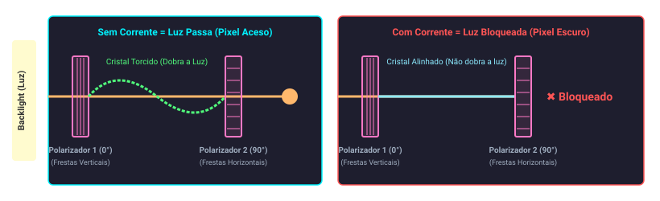

    

  A primeira placa só deixa passar luz na vertical (0°) e a segunda placa só deixa passar na horizontal (90°)
  

> **3. Pixéis & Bit Map**
>
> A imagem é uma matriz de elementos chamados *pixels*, representada na memória como uma matriz de bits (**Bit Map**).
>
> - **Resolução da tela:** é determinada pela quantidade de pixels dispostos em matriz (ex: 1024 x 768 ou 2048 x 1536.
> - **Profundidade de cor:** utilizam-se **24 bits por pixel** (8 bits para a intensidade de cada cor primária: Vermelho, Verde e Azul), permitindo exibir mais de 16 milhões de cores.

  

  

> **4. Frame Buffer**
>
> Memória especial de hardware que armazena o mapa de bits. O padrão de bits é lido continuamente e enviado ao ecrã conforme a taxa de atualização.

  

   

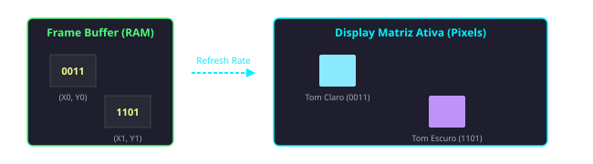

> **5. Touchscreen**
>
> Já para a tecnologia **touchscreen**, muitos tablets modernos usam o sensor capacitivo. O ecrã aproveita o facto de que o corpo humano é um condutor de eletricidade para registar o seu toque:
>
> - A superfície do ecrã possui um material isolante, como o vidro, que é coberto por um condutor transparente.
> - Ao encostar no ecrã, o seu dedo funciona como um íman elétrico e distorce o **campo eletrostático** daquele ponto.
> - Esse toque resulta numa mudança na **capacitância** (uma alteração na carga elétrica local) do ecrã. É através da leitura desta distorção invisível que o sistema sabe exatamente onde tocou.

| **Característica**                 | **CRT (Tubo de Raios Catódicos)**                                                           | **LCD (Cristal Líquido Tradicional)**                                                                           | **LED (LCD iluminado por LED)**                                                                                   |
| ---------------------------------- | ------------------------------------------------------------------------------------------- | --------------------------------------------------------------------------------------------------------------- | ----------------------------------------------------------------------------------------------------------------- |
| **Como forma a imagem**            | Feixes de elétrons são disparados contra uma camada de fósforo no vidro, fazendo-a brilhar. | Moléculas de cristal líquido torcem ou bloqueiam a passagem da luz.                                             | Moléculas de cristal líquido torcem ou bloqueiam a passagem da luz.                                               |
| **Fonte de Luz**                   | O próprio fósforo emite a luz ao ser atingido pelos elétrons.                               | Lâmpadas fluorescentes de cátodo frio (CCFL), parecidas com lâmpadas de escritório, atrás da tela.              | Diodos Emissores de Luz (LEDs) posicionados atrás ou nas bordas da tela.                                          |
| **Formato e Peso**                 | Muito pesado, com uma traseira longa e volumosa devido ao tubo de vidro a vácuo.            | Fino e leve, permitindo telas planas.                                                                           | Ultrafino e muito leve, já que os LEDs ocupam pouquíssimo espaço.                                                 |
| **Consumo de Energia**             | Altíssimo, gerando bastante calor no ambiente.                                              | Baixo, mas as lâmpadas fluorescentes ainda consomem mais que a tecnologia mais nova.                            | Muito baixo e altamente eficiente, esquentando quase nada.                                                        |
| **Qualidade do Preto (Contraste)** | Excelente. Onde é preto, não há feixe de elétrons, ficando totalmente escuro.               | Mediano. A lâmpada fluorescente fica sempre acesa e a luz acaba vazando um pouco, deixando o preto acinzentado. | Muito boa. Monitores modernos conseguem desligar os LEDs em áreas específicas, entregando um preto mais profundo. |

### 1.4.2 Por Dentro

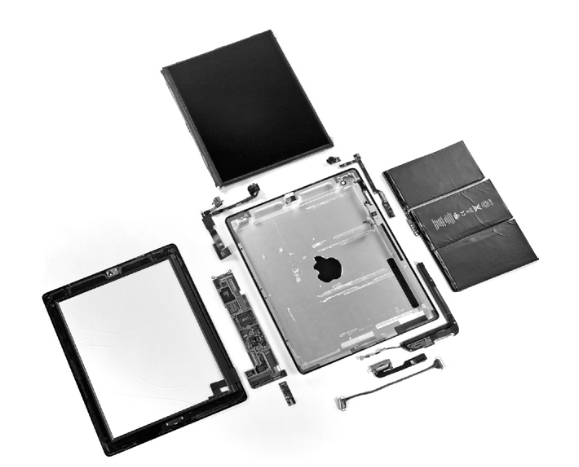

Utilizando um tablet (iPad 2) como exemplo, a grande maioria do espaço interno do aparelho é dedicada a dispositivos de I/O e baterias, incluindo a tela capacitiva, câmeras, microfone, alto-falantes, redes sem fio e sensores de movimento. A parte que realiza a computação de fato (processador e memória) ocupa uma porção minúscula do espaço.

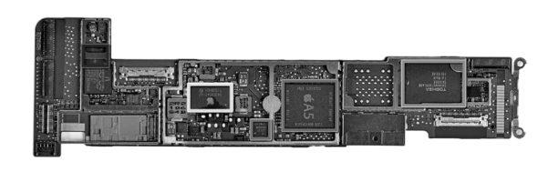

O processador é um chip, sendo este o nome informal dado a um circuito integrado. Estes dispositivos combinam de dezenas a milhões de transístores numa única peça. Durante o processo de fabrico, a secção retangular cortada de uma placa de silício (_wafer_) que contém o processador é tecnicamente designada por matriz (_die_), mas no dia a dia é mais vulgarmente conhecida como chip.

**Dentro do A5:**

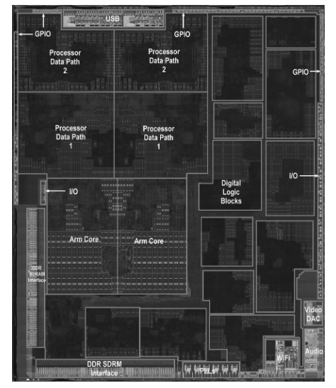

**O Processador (CPU):** É a parte ativa do computador, responsável por seguir as instruções do programa à risca (somar números, testar valores, ativar funções). Ele se divide em dois componentes lógicos principais:
- **Datapath (Caminho de Dados):** É o "músculo" do processador, que executa as operações aritméticas.
- **Control (Controle):** É o "cérebro" que comanda o datapath, a memória e os dispositivos de I/O sobre o que deve ser feito de acordo com o programa.

A memória é dividida entre tecnologias voláteis (perdem os dados sem eletricidade) e não voláteis (mantêm o armazenamento armazenado), organizadas em camadas para balancear velocidade, capacidade e custo.

| Conceito | Descrição |
| :-- | :-- |
| **1. DRAM (Memória Dinâmica de Acesso Aleatório)** | Usada como a memória principal, é onde os programas e seus dados ficam guardados enquanto estão em execução. "Acesso aleatório" significa que o tempo de leitura é o mesmo não importa em qual parte da memória o dado esteja. É uma memória volátil, o que significa que ela "esquece" tudo quando fica sem energia. |
| **2. Memória Cache (SRAM)** | Fica dentro do processador e atua como um "amortecedor" (buffer) menor e incrivelmente rápido para a DRAM. A SRAM (Memória Estática de Acesso Aleatório) é mais rápida que a DRAM, porém guarda menos informações e é mais cara. |
| **3. Memória Secundária (Não-volátil)** | É o armazenamento permanente que não perde os dados quando o aparelho é desligado. Aparelhos móveis usam memória flash (um tipo de semicondutor) em vez de discos rígidos mecânicos. A memória flash é mais barata que a DRAM, mas tem a desvantagem de se desgastar fisicamente após 100 mil a 1 milhão de gravações de dados. |
| **4. Discos Magnéticos (HDDs)** | Armazenamento secundário não volátil mecânico baseado em discos giratórios. Muito mais lento, porém com menor custo por gigabyte. |

A hierarquia resolve a contradição entre velocidade e custo: o topo é ultra rápido, pequeno, caro e a base é lenta, gigante e barata.

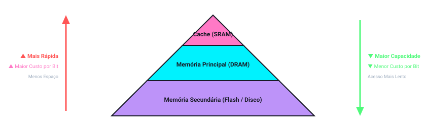

A ISA (Instruction Set Architecture) é a abstração mais importante da computação: a fronteira entre o hardware e o software de baixo nível.

| Conceito | Descrição |
| :-- | :-- |
| **1. ISA (Arquitetura)** | Interface abstrata com tudo o que o programador/compilador precisa saber: instruções, registradores e memória. |
| **2. ABI (Interface Binária)** | Combina a ISA com o sistema operacional. Define o padrão para a portabilidade binária de programas de aplicação. |
| **3.Implementação** | O hardware físico real que obedece à ISA. Permite que chips de custos e desempenhos diferentes executem o mesmo código. |

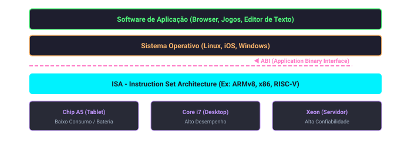

As redes interconectam computadores inteiros, permitindo estender o poder da computação através da comunicação.

- **Principais Vantagens de Computadores em Rede:**
    - **Comunicação:** Permite a troca de informações entre computadores em alta velocidade.
    - **Compartilhamento de Recursos:** Evita que cada computador precise ter seus próprios dispositivos de I/O, permitindo o compartilhamento na rede.
    - **Acesso Remoto (_Nonlocal Access_):** Conecta computadores a longas distâncias, dispensando a necessidade de o usuário estar fisicamente próximo da máquina que está a utilizar.

| LAN (Local Area Network - Rede de Área Local)                                                                                                                                                                                                                                                                                                            | WAN (Wide Area Network - Rede de Longa Distância)                                                                                                                                           |
| -------------------------------------------------------------------------------------------------------------------------------------------------------------------------------------------------------------------------------------------------------------------------------------------------------------------------------------------------------- | ------------------------------------------------------------------------------------------------------------------------------------------------------------------------------------------- |
| Projetada para transferir dados em áreas geograficamente limitadas, tipicamente dentro de um único edifício. O exemplo mais popular é o **Ethernet**, que pode alcançar até um quilômetro de extensão e transferir até 40 gigabits por segundo. As LANs utilizam _switches_ para interconexão, providenciando também serviços de roteamento e segurança. | Estende-se por centenas de quilômetros, cruza continentes e forma a espinha dorsal da Internet e da web. Tipicamente utilizam fibras ópticas e são alugadas a empresas de telecomunicações. |

- **Evolução e Tecnologia Sem Fio (Wireless):**
    - Há 30 anos, a Internet e o correio eletrônico eram quase inexistentes, e o envio físico de fitas magnéticas era o principal meio para transferir grandes volumes de dados. As capacidades das redes evoluíram drasticamente de megabits para gigabits.
    - A tecnologia sem fio (padronizada pelo IEEE como **802.11**) é construída com a mesma tecnologia de semicondutores de baixo custo (**CMOS**) usada em microprocessadores, permitindo taxas de transmissão de 1 a quase 100 milhões de bits por segundo e viabilizando a era pós-PC. Ao contrário das redes cabeadas, todos os usuários de uma rede sem fio compartilham o mesmo espaço aéreo (_airwaves_) em uma área imediata.

# 1.5 Tecnologias para Construir Processadores e Memória

Processadores e memórias evoluíram a uma velocidade incrível porque os projetistas sempre adotaram a tecnologia eletrônica mais recente na corrida por computadores melhores. Como essa tecnologia define o que os computadores podem fazer e a rapidez com que evoluem, todo profissional da área deve conhecer o básico sobre **circuitos integrados**.

 

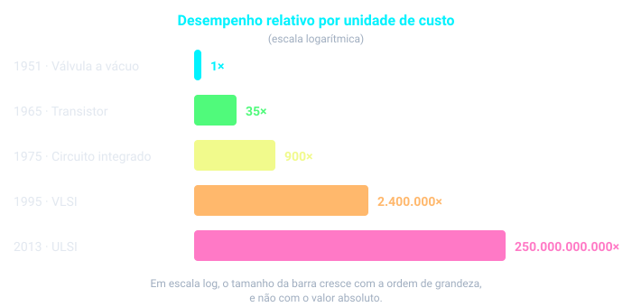

 

 

| Conceito | Descrição |
| :-- | :-- |
| **1. Transistor** | Simplesmente um **interruptor liga/desliga controlado por eletricidade**. |
| **2. Circuito Integrado (IC)** | Combinou de dezenas a centenas de transistores em um único chip. Quando Gordon Moore previu a duplicação contínua de recursos, estava prevendo o crescimento do número de **transistores por chip**. |
| **3. VLSI** | *Very Large-Scale Integrated circuit*. O adjetivo "muito grande escala" descreve o salto de centenas para milhões de transistores em um chip. |

 

 

> **Crescimento da capacidade da DRAM**
>
> A taxa de integração tem sido notavelmente estável. Desde 1977, a indústria **quadruplicou a capacidade a cada 3 anos**, o que resultou em um aumento superior a **16.000 vezes**.
>
> - Isso equivale a cerca de **60% de crescimento ao ano**, durante 20 anos.
> - Nos últimos anos o ritmo desacelerou, e hoje está mais próximo de **dobrar a cada 2 a 3 anos**.

 

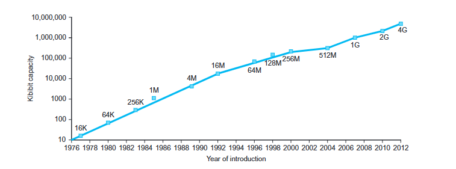

## 1.5.1 Do Silício ao Transistor

A fabricação de um chip começa com o **silício**, substância encontrada na areia. Como o silício não conduz bem a eletricidade, ele é chamado de **semicondutor**. Com um processo químico especial, é possível adicionar materiais ao silício para que pequenas áreas se transformem em uma dessas três coisas:

| Conceito | Descrição |
| :-- | :-- |
| **Excelentes condutores** | Fios microscópicos de cobre ou alumínio. |
| **Excelentes isolantes** | Parecidos com a cobertura de plástico ou com o vidro. |
| **Condutor ou isolante, sob certas condições** | Funcionam como um **interruptor**. Os **transistores** pertencem a esta categoria. |

 

> **Nota:** Um circuito VLSI é apenas bilhões de combinações de condutores, isolantes e interruptores fabricados em um único pacote pequeno.

## 1.5.2 Processo de Fabricação

O processo de fabricação é crítico para o **custo** dos chips e, por isso, importante para os projetistas.

- O processo começa com um **lingote de cristal de silício**, que parece uma salsicha gigante.
- O lingote é fatiado em **wafers** (bolachas) com no máximo 0,1 polegada de espessura.
- Os wafers passam por uma série de etapas em que padrões de produtos químicos são depositados, criando os transistores, condutores e isolantes.
- Os circuitos integrados de hoje têm **apenas uma camada de transistores**, mas de **2 a 8 níveis de condutores metálicos**, separados por camadas de isolantes.

 

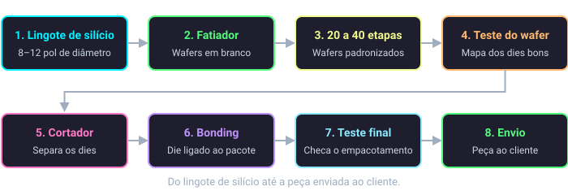

 

## 1.5.3 Defeitos, Dies e Yield

| Conceito | Descrição |
| :-- | :-- |
| **1. Defeito** | Uma falha microscópica no wafer ou em uma das dezenas de etapas de padronização faz aquela área falhar. Os defeitos tornam **praticamente impossível fabricar um wafer perfeito**. |
| **2. Solução: Dicing** | Colocar muitos componentes independentes em um único wafer e depois **cortá-lo em dies**. Assim se descartam só os dies azarados que continham falhas, e não o wafer inteiro. |
| **3. Yield (Rendimento)** | É a **porcentagem de dies bons** em relação ao total de dies do wafer. |
| **4. Custo x Tamanho do Die** | O custo sobe rápido com o tamanho do die: o **yield cai** e **cabem menos dies** no wafer. |

 

 

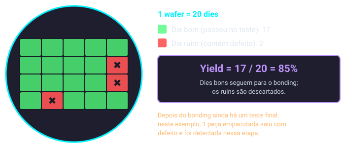

 

 

> **Exemplo real: wafer do Intel Core i7**
>
> - Wafer de **12 polegadas (300 mm)**, com **280 dies** se o yield fosse 100%. Cada die mede **20,7 x 10,5 mm**.
> - Os chips parcialmente arredondados na borda são inúteis. Eles existem porque é mais fácil criar as máscaras de padronização assim.
> - Tecnologia de **32 nanômetros**: o menor elemento do die tem cerca de 32 nm. Esse valor se refere ao tamanho do transistor "desenhado", normalmente um pouco maior que o tamanho final fabricado.
> - Para reduzir o custo, usa-se a **próxima geração do processo**, que encolhe um die grande com transistores e fios menores. Isso melhora o yield e o número de dies por wafer. Em 2012, o processo de 32 nm era típico.

 

## 1.5.4 Bonding e Teste Final

Com os dies bons identificados, eles são conectados aos **pinos de entrada/saída (I/O)** de um pacote, em um processo chamado **bonding**. As peças empacotadas passam por **um último teste**, já que podem ocorrer erros durante o empacotamento, e só então são enviadas aos clientes.

## 1.5.5 Elaboração: Equações de Custo

O custo de um circuito integrado pode ser expresso por três equações simples:

$$\text{Custo por die} = \frac{\text{Custo por wafer}}{\text{Dies por wafer} \times \text{yield}}$$

$$\text{Dies por wafer} \approx \frac{\text{Área do wafer}}{\text{Área do die}}$$

$$\text{Yield} = \frac{1}{\left(1 + \left(\text{Defeitos por área} \times \text{Área do die} / 2\right)\right)^2}$$

| Conceito | Descrição |
| :-- | :-- |
| **1ª equação** | Direta de derivar: o custo do wafer é dividido pelos dies que realmente funcionam. |
| **2ª equação** | É uma **aproximação**, pois não desconta a área da borda do wafer redondo que não comporta dies retangulares (veja o wafer do Core i7). |
| **3ª equação** | Baseada em **observações empíricas** de yields em fábricas de circuitos integrados. O expoente está relacionado ao número de etapas críticas do processo. |

 

> **Nota:** Dependendo da taxa de defeitos e do tamanho do die e do wafer, os custos geralmente **não são lineares** em relação à área do die.

## Glossário da Seção

| **Termo**                         | **Definição**                                                                                    |
| --------------------------------- | ------------------------------------------------------------------------------------------------ |
| **Transistor**                    | Interruptor liga/desliga controlado por um sinal elétrico.                                       |
| **VLSI**                          | Dispositivo que contém de centenas de milhares a milhões de transistores.                        |
| **Silício**                       | Elemento natural que é um semicondutor.                                                          |
| **Semicondutor**                  | Substância que não conduz bem a eletricidade.                                                    |
| **Lingote de cristal de silício** | Barra de cristal de silício com 8 a 12 polegadas de diâmetro e 12 a 24 polegadas de comprimento. |
| **Wafer**                         | Fatia de um lingote de silício, com no máximo 0,1 polegada de espessura, usada para criar chips. |
| **Defeito**                       | Falha microscópica no wafer ou nas etapas de padronização que causa a falha do die que a contém. |
| **Die**                           | Cada seção retangular cortada de um wafer, mais informalmente chamada de chip.                   |
| **Yield**                         | Porcentagem de dies bons em relação ao total de dies do wafer.                                   |

# 1.6 Performance

Avaliar o desempenho de computadores é difícil: a complexidade do software moderno e a variedade de técnicas de otimização de hardware tornaram a medição muito mais complicada. Mesmo assim, medir e comparar corretamente é essencial para quem compra (e, portanto, para quem projeta), e é preciso saber **o que cada métrica mede e quais são seus limites**, já que quem vende sempre quer mostrar o computador sob a melhor luz.

## 1.6.1 Definindo Desempenho

Dizer que um computador tem "melhor desempenho" depende da definição. A analogia com aviões de passageiros mostra isso:

|Avião|Capacidade (passageiros)|Alcance (milhas)|Velocidade de cruzeiro (mph)|Throughput (passageiros × mph)|
|---|---|---|---|---|
|Boeing 777|375|4630|610|228.750|
|Boeing 747|470|4150|610|**286.700**|
|BAC/Sud Concorde|132|4000|**1350**|178.200|
|Douglas DC-8-50|146|**8720**|544|79.424|

- Maior **velocidade** de cruzeiro: Concorde (levaria 1 passageiro de A até B no menor tempo).
- Maior **alcance**: DC-8.
- Maior **capacidade** e maior taxa de transporte de passageiros (para levar 450 pessoas): 747.

O mesmo vale para computadores. Existem duas formas de medir:

| Conceito | Descrição |
| :-- | :-- |
| **1. Tempo de Resposta (Execution Time)** | O tempo entre o início e o fim de uma tarefa. Inclui acessos a disco, acessos à memória, atividades de I/O, overhead do sistema operacional, tempo de execução da CPU, etc. É o que interessa ao **usuário individual**: o computador mais rápido é o que termina o trabalho primeiro. |
| **2. Throughput (Largura de Banda)** | A quantidade total de trabalho feita em um dado tempo (tarefas concluídas por unidade de tempo). É o que interessa ao **gerente de data center**: o servidor mais rápido é o que completa mais jobs por dia. |

 

Por isso, dispositivos móveis (PMDs) focam mais em **tempo de resposta**, enquanto servidores focam mais em **throughput**, e cada um exige conjuntos diferentes de aplicações para fazer benchmark.

> **Exemplo: Throughput e Tempo de Resposta** As mudanças abaixo aumentam o throughput, diminuem o tempo de resposta ou ambos?
> 
> 1. Trocar o processador por uma versão mais rápida.
> 2. Adicionar mais processadores a um sistema que usa vários processadores para tarefas separadas (ex.: busca na web).
> 
> **Resposta:**
> 
> - **Caso 1:** ambos melhoram. Diminuir o tempo de resposta quase sempre melhora o throughput.
> - **Caso 2:** nenhuma tarefa individual fica mais rápida, então só o **throughput** aumenta.
> 
> Porém, se a demanda for quase tão grande quanto o throughput, as requisições formam fila. Nesse caso, aumentar o throughput também reduz o tempo de espera na fila e, portanto, melhora o tempo de resposta. Em sistemas reais, mexer em um costuma afetar o outro.

Nos primeiros capítulos o foco será o **tempo de resposta**. Para maximizar o desempenho, queremos minimizar o tempo de execução, então:

$$\text{Desempenho}_X = \frac{1}{\text{Tempo de execução}_X}$$

Se o desempenho de X é maior que o de Y:

$$\text{Desempenho}_X > \text{Desempenho}_Y \;\Rightarrow\; \frac{1}{\text{Tempo}_X} > \frac{1}{\text{Tempo}_Y} \;\Rightarrow\; \text{Tempo}_Y > \text{Tempo}_X$$

Ou seja, o tempo de execução em Y é maior do que em X se X é mais rápido que Y.

Para comparar quantitativamente, dizemos que "**X é n vezes mais rápido que Y**" quando:

$$\frac{\text{Desempenho}_X}{\text{Desempenho}_Y} = \frac{\text{Tempo de execução}_Y}{\text{Tempo de execução}_X} = n$$

> **Exemplo: Desempenho Relativo** O computador A roda um programa em 10 s e o B roda o mesmo programa em 15 s. Quanto A é mais rápido que B?
> 
> $$\frac{\text{Desempenho}_A}{\text{Desempenho}_B} = \frac{\text{Tempo}_B}{\text{Tempo}_A} = \frac{15}{10} = 1{,}5$$
> 
> **A é 1,5 vez mais rápido que B.**

> **Nota:** Como desempenho e tempo de execução são inversos, aumentar o desempenho exige diminuir o tempo. Para evitar confusão entre "aumentar" e "diminuir", usa-se **"melhorar o desempenho"** ou **"melhorar o tempo de execução"**. O livro prefere o termo _"X vezes mais rápido"_ (e não "mais lento") nas comparações.

## 1.6.2 Medindo Desempenho

**Tempo é a medida de desempenho**: o computador que faz a mesma quantidade de trabalho no menor tempo é o mais rápido. Mas o tempo pode ser definido de formas diferentes, dependendo do que se conta.

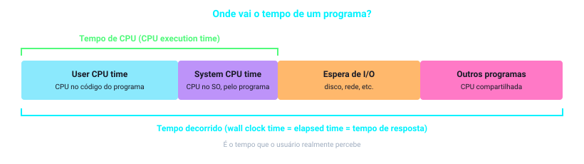

 

|Medida|O que inclui|
|---|---|
|**Tempo decorrido** (_wall clock_, _elapsed time_, tempo de resposta)|O tempo total para completar a tarefa: acessos a disco e memória, I/O, overhead do SO, tudo.|
|**Tempo de CPU** (_CPU execution time_)|O tempo que a CPU gasta computando **para aquela tarefa**. Não inclui espera por I/O nem a execução de outros programas.|
|**User CPU time**|A parte do tempo de CPU gasta no próprio programa.|
|**System CPU time**|A parte do tempo de CPU gasta no sistema operacional, executando tarefas em nome do programa.|

- Os computadores costumam ser **compartilhados**: o processador pode trabalhar em vários programas ao mesmo tempo, e o sistema pode tentar otimizar o throughput em vez de minimizar o tempo decorrido de um único programa. Por isso é útil distinguir tempo decorrido de tempo de CPU.
- Mas lembre: o tempo de resposta sentido pelo usuário é o **tempo decorrido**, não o tempo de CPU.
- Separar _user_ de _system_ CPU time com precisão é difícil, pois nem sempre dá para atribuir uma atividade do SO a um programa específico, e os sistemas operacionais têm funcionalidades diferentes.

> **Nota (terminologia do livro):** **desempenho do sistema** = tempo decorrido em um sistema sem carga. **Desempenho da CPU** = _user CPU time_. Neste capítulo o foco é o desempenho da CPU.

> **Entendendo o Desempenho de Programas:** Aplicações diferentes são sensíveis a aspectos diferentes do sistema. Muitas aplicações (principalmente em servidores) dependem tanto da performance de **I/O** (que depende de hardware e software) quanto da CPU, e aí o tempo decorrido total é a medida de interesse. O usuário pode se importar com throughput, tempo de resposta ou uma combinação (ex.: throughput máximo com tempo de resposta de pior caso limitado). Para melhorar um programa é preciso **definir qual métrica importa**, medir a execução e procurar os gargalos.

### Ciclos de Clock

Embora o usuário se preocupe com tempo, o projetista de hardware prefere métricas ligadas à rapidez com que o hardware executa funções básicas. Quase todos os computadores têm um **clock** que determina quando os eventos acontecem no hardware.

| Conceito | Descrição |
| :-- | :-- |
| **Ciclo de Clock** | Cada intervalo discreto de tempo do clock (também chamado de *tick*, *clock tick*, *clock period*, *clock* ou *cycle*). |
| **Período de Clock** | A duração de um ciclo completo. Ex.: **250 ps** (picossegundos). |
| **Taxa de Clock (Clock Rate)** | O **inverso** do período. Ex.: **4 GHz**. |

 

$$\text{Taxa de clock} = \frac{1}{\text{Período de clock}} \qquad \left(\frac{1}{250\text{ ps}} = 4\text{ GHz}\right)$$

## 1.6.3 Desempenho da CPU e Seus Fatores

Usuários e projetistas olham métricas diferentes. Se conseguirmos relacioná-las, dá para saber como uma mudança no projeto afeta o desempenho percebido pelo usuário. Como estamos restritos ao desempenho da CPU, a medida final é o **tempo de execução da CPU**:

$$\text{Tempo de CPU} = \text{Ciclos de clock da CPU} \times \text{Período de clock}$$

$$\text{Tempo de CPU} = \frac{\text{Ciclos de clock da CPU}}{\text{Taxa de clock}}$$

O projetista pode melhorar o desempenho **reduzindo o número de ciclos** necessários para o programa **ou reduzindo o período do clock**. Só que existe um _trade-off_: muitas técnicas que diminuem o número de ciclos aumentam o período do clock.

> **Exemplo: Melhorando o Desempenho** O programa roda em 10 s no computador A (clock de 2 GHz). Queremos construir o B para rodar em 6 s. O aumento da taxa de clock afeta o resto do projeto, e B vai precisar de **1,2 vez** mais ciclos que A. Qual taxa de clock B deve ter?
> 
> **Ciclos de A:**
>
> $$\text{Ciclos}_A = \text{Tempo}_A \times \text{Taxa}_A = 10\text{ s} \times 2\times10^9\,\tfrac{\text{ciclos}}{\text{s}} = 20\times10^9\text{ ciclos}$$
> 
> **Tempo de B:**
>
> $$6\text{ s} = \frac{1{,}2 \times 20\times10^9\text{ ciclos}}{\text{Taxa}_B} \;\Rightarrow\; \text{Taxa}_B = \frac{1{,}2 \times 20\times10^9}{6} = 4\times10^9\,\tfrac{\text{ciclos}}{\text{s}} = 4\text{ GHz}$$
> 
> **B precisa do dobro da taxa de clock de A.**

## 1.6.4 Desempenho de Instruções (CPI)

As equações acima não mencionam o **número de instruções**, mas o compilador gerou instruções e o computador precisou executá-las, então o tempo de execução depende delas. Uma forma de pensar: _tempo = instruções executadas × tempo médio por instrução_. Logo:

$$\text{Ciclos de clock da CPU} = \text{Instruções do programa} \times \text{Média de ciclos por instrução}$$

> **CPI (_Clock cycles Per Instruction_):** número **médio** de ciclos que cada instrução leva para executar. É uma média, pois instruções diferentes levam tempos diferentes. Permite comparar duas **implementações da mesma ISA**, já que o número de instruções executadas será o mesmo.

> **Exemplo: Usando a Equação de Desempenho** Mesma ISA, mesmo programa:
> 
> - **A:** ciclo de clock de 250 ps, CPI = 2,0
> - **B:** ciclo de clock de 500 ps, CPI = 1,2
> 
> Qual é mais rápido e por quanto? Seja $I$ o número de instruções (igual nos dois).
> 
> $$\text{Ciclos}_A = I \times 2{,}0 \qquad \text{Ciclos}_B = I \times 1{,}2$$
>
> $$\text{Tempo}_A = I \times 2{,}0 \times 250\text{ ps} = 500\,I\text{ ps}$$
>
> $$\text{Tempo}_B = I \times 1{,}2 \times 500\text{ ps} = 600\,I\text{ ps}$$
>
> $$\frac{\text{Desempenho}_A}{\text{Desempenho}_B} = \frac{\text{Tempo}_B}{\text{Tempo}_A} = \frac{600\,I}{500\,I} = 1{,}2$$
> 
> **A é 1,2 vez mais rápido que B** para esse programa.

## 1.6.5 A Equação Clássica de Desempenho da CPU

Combinando tudo em termos de **contagem de instruções** (número de instruções executadas pelo programa), CPI e período de clock:

$$\text{Tempo de CPU} = \text{Contagem de instruções} \times \text{CPI} \times \text{Período de clock}$$

$$\text{Tempo de CPU} = \frac{\text{Contagem de instruções} \times \text{CPI}}{\text{Taxa de clock}}$$

Elas são úteis porque **separam os três fatores-chave** do desempenho. Dá para comparar duas implementações ou avaliar uma alternativa de projeto se soubermos o impacto dela nesses três parâmetros.

$$\text{Tempo} = \frac{\text{Segundos}}{\text{Programa}} = \frac{\text{Instruções}}{\text{Programa}} \times \frac{\text{Ciclos de clock}}{\text{Instrução}} \times \frac{\text{Segundos}}{\text{Ciclo de clock}}$$

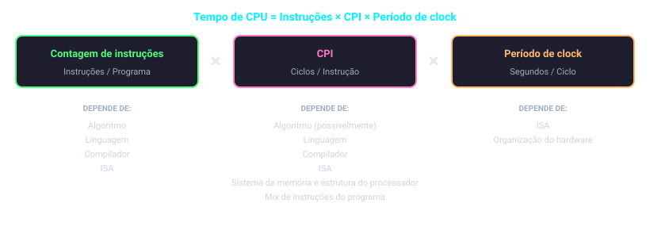

 

|Componente de desempenho|Unidade de medida|
|---|---|
|**Tempo de execução da CPU** do programa|Segundos por programa|
|**Contagem de instruções**|Instruções executadas pelo programa|
|**CPI**|Média de ciclos de clock por instrução|
|**Período de clock**|Segundos por ciclo de clock|

> **Exemplo: Comparando Sequências de Código** Um projetista de compilador escolhe entre duas sequências de código para o mesmo comando de alto nível. O hardware informa o CPI de cada classe de instrução:
> 
> |Classe de instrução|A|B|C|
> |---|---|---|---|
> |**CPI**|1|2|3|
> 
> |Sequência|Contagem A|Contagem B|Contagem C|Total de instruções|
> |---|---|---|---|---|
> |**1**|2|1|2|5|
> |**2**|4|1|1|6|
> 
> A sequência 1 executa **menos instruções** (5 contra 6). Para saber qual é mais rápida, calcula-se o total de ciclos:
> 
> $$\text{Ciclos} = \sum_{i=1}^{n} (\text{CPI}_i \times C_i)$$
>
> $$\text{Ciclos}_1 = (2\times1) + (1\times2) + (2\times3) = 2 + 2 + 6 = 10\text{ ciclos}$$
>
> $$\text{Ciclos}_2 = (4\times1) + (1\times2) + (1\times3) = 4 + 2 + 3 = 9\text{ ciclos}$$
> 
> **A sequência 2 é mais rápida**, mesmo executando uma instrução a mais, então ela tem CPI menor:
> 
> $$\text{CPI} = \frac{\text{Ciclos}}{\text{Contagem de instruções}} \qquad \text{CPI}_1 = \frac{10}{5} = 2{,}0 \qquad \text{CPI}_2 = \frac{9}{6} = 1{,}5$$

> **Visão Geral (_The Big Picture_):** A **única medida completa e confiável** de desempenho de computadores é o **tempo**. Por exemplo, mudar a ISA para diminuir a contagem de instruções pode levar a uma organização com clock mais lento ou CPI mais alto, anulando o ganho. E, como o CPI depende do tipo de instrução executada, o código com **menos instruções** pode **não** ser o mais rápido.

### Como medir cada fator?

| Conceito | Descrição |
| :-- | :-- |
| **Tempo de CPU** | Medido simplesmente **rodando o programa**. |
| **Período de clock** | Geralmente **publicado na documentação** do computador. |
| **Contagem de instruções e CPI** | Mais difíceis de obter. Usam-se **ferramentas de profiling**, um **simulador** da arquitetura ou **contadores de hardware** (presentes na maioria dos processadores, registram instruções executadas, CPI médio e fontes de perda de desempenho). |

 

- Se conhecemos a taxa de clock e o tempo de CPU, basta saber **um** entre contagem de instruções e CPI para descobrir o outro.
- A **contagem de instruções** depende da _arquitetura_ (ISA), mas não da implementação exata, então dá para medi-la sem conhecer os detalhes do hardware.
- O **CPI** depende de muitos detalhes do projeto (sistema de memória, estrutura do processador) e do **mix de instruções** (frequência dinâmica das instruções em um ou mais programas). Logo, o CPI varia entre aplicações e entre implementações da mesma ISA.

> **Perigo de olhar um fator só:** O exemplo acima mostra o risco de usar apenas a contagem de instruções. Ao comparar dois computadores é preciso olhar **os três componentes**. Se alguns fatores forem idênticos (ex.: mesma taxa de clock), a comparação pode ser feita pelos fatores diferentes. Como o CPI varia com o mix de instruções, é preciso comparar contagem de instruções **e** CPI, mesmo com clocks iguais. (Na Seção 1.10 há uma medida comum que não incorpora todos os termos e por isso engana.)

### O que afeta cada fator?

O desempenho de um programa depende do **algoritmo**, da **linguagem**, do **compilador**, da **arquitetura** e do **hardware** real:

|Componente (hardware ou software)|Afeta o quê?|Como?|
|---|---|---|
|**Algoritmo**|Contagem de instruções, possivelmente CPI|Determina o número de instruções do código-fonte executadas e, portanto, de instruções de máquina. Pode afetar o CPI ao favorecer instruções mais lentas ou mais rápidas (ex.: mais divisões → CPI maior).|
|**Linguagem de programação**|Contagem de instruções, CPI|Os comandos da linguagem são traduzidos em instruções de máquina. Também afeta o CPI: uma linguagem com muito suporte a abstração de dados (ex.: Java) usa chamadas indiretas, que têm CPI mais alto.|
|**Compilador**|Contagem de instruções, CPI|Determina a tradução da linguagem-fonte para instruções de máquina. Seu papel pode ser muito complexo e afetar o CPI de várias formas.|
|**Arquitetura do conjunto de instruções (ISA)**|Contagem de instruções, taxa de clock, CPI|Afeta os **três** aspectos: as instruções necessárias para uma função, o custo em ciclos de cada instrução e a taxa de clock do processador.|

> **Elaboração (IPC):** Embora se espere que o CPI mínimo seja 1,0, alguns processadores buscam e executam **várias instruções por ciclo**. Por isso alguns projetistas usam o inverso do CPI, o **IPC** (_instructions per clock cycle_). Se o processador executa em média 2 instruções por ciclo, IPC = 2 e CPI = 0,5.

> **Elaboração (Turbo mode):** Tradicionalmente o período de clock é fixo, mas processadores atuais podem **variar a taxa de clock** para economizar energia ou ganhar desempenho temporário, então é preciso usar a taxa de clock **média** do programa. Ex.: o Intel Core i7 aumenta o clock em cerca de 10% até o chip esquentar demais (o que a Intel chama de **Turbo mode**).

### Check Yourself

> **Questão 1:** O computador C tem desempenho 4 vezes o do computador B, que roda uma aplicação em 28 s. Quanto tempo C leva?
> 
> $$\text{Tempo}_C = \frac{\text{Tempo}_B}{4} = \frac{28}{4} = 7\text{ s}$$

> **Questão 2:** Uma aplicação Java roda em 15 s. Um novo compilador gera apenas **0,6** das instruções do antigo, mas aumenta o CPI em **1,1** vez. Quanto tempo leva agora?
> 
> O clock não muda, então só importam contagem de instruções e CPI: $$15 \times 0{,}6 \times 1{,}1 = 9{,}9\text{ s}$$ **Alternativa (b).**

## Glossário da Seção

| **Termo**                               | **Definição**                                                                                                       |
| --------------------------------------- | ------------------------------------------------------------------------------------------------------------------- |
| **Tempo de resposta (execution time)**  | Tempo total para o computador completar uma tarefa, incluindo acessos a disco e memória, I/O, overhead do SO e CPU. |
| **Throughput (largura de banda)**       | Número de tarefas concluídas por unidade de tempo.                                                                  |
| **Wall clock time (elapsed time)**      | Tempo total decorrido para completar a tarefa, medido por um relógio de parede.                                     |
| **Tempo de CPU (CPU execution time)**   | Tempo real que a CPU gasta computando uma tarefa específica.                                                        |
| **User CPU time**                       | Tempo de CPU gasto no próprio programa.                                                                             |
| **System CPU time**                     | Tempo de CPU gasto no sistema operacional realizando tarefas em nome do programa.                                   |
| **Ciclo de clock (clock cycle)**        | O tempo de um período de clock, geralmente do clock do processador, que roda a uma taxa constante.                  |
| **Período de clock (clock period)**     | A duração de cada ciclo de clock.                                                                                   |
| **Taxa de clock (clock rate)**          | O inverso do período de clock (ex.: 4 GHz).                                                                         |
| **CPI**                                 | Média de ciclos de clock por instrução para um programa ou trecho de programa.                                      |
| **Contagem de instruções**              | Número de instruções executadas pelo programa.                                                                      |
| **Mix de instruções (instruction mix)** | Medida da frequência dinâmica das instruções ao longo de um ou vários programas.                                    |
| **IPC**                                 | Instruções por ciclo de clock (inverso do CPI).                                                                     |
| **Turbo mode**                          | Aumento temporário da taxa de clock (≈10% no Core i7) até o chip esquentar demais.                                  |

# 1.7 O Power Wall (Barreira de Potência)

Durante décadas, a **taxa de clock** e a **potência** dos microprocessadores cresceram rapidamente e juntas, e só recentemente estabilizaram. Elas cresceram juntas porque são **correlacionadas**, e desaceleraram porque chegamos ao **limite prático de refrigeração** dos microprocessadores comuns (_commodity_).

## 1.7.1 Clock e Potência em 30 Anos de Intel x86

|Processador (ano)|Taxa de clock (MHz)|Potência (W)|
|---|---|---|
|80286 (1982)|12,5|3,3|
|80386 (1985)|16|4,1|
|80486 (1989)|25|4,9|
|Pentium (1993)|66|10,1|
|Pentium Pro (1997)|200|29,1|
|Pentium 4 Willamette (2001)|2000|75,3|
|Pentium 4 Prescott (2004)|**3600**|**103**|
|Core 2 Kentsfield (2007)|2667|95|
|Core i5 Clarkdale (2010)|3300|87|
|Core i5 Ivy Bridge (2012)|3400|77|

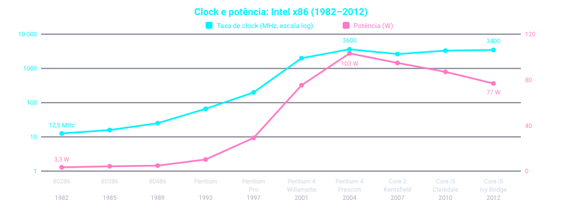

 

- O **Pentium 4** deu um salto enorme em clock e potência, mas bem menor em desempenho. Os problemas térmicos do **Prescott** levaram ao abandono da linha Pentium 4.
- A linha **Core 2** voltou a um _pipeline_ mais simples, com clocks menores e **vários processadores por chip**. Os **Core i5** seguem o mesmo caminho.

## 1.7.2 Potência vs Energia

Embora a potência limite o que conseguimos resfriar, na era pós-PC o recurso realmente valioso é a **energia**: a vida útil da bateria pode ser mais importante que o desempenho em um PMD, e os arquitetos de _warehouse scale computers_ tentam reduzir o custo de alimentar e refrigerar 100.000 servidores.

| Conceito | Descrição |
| :-- | :-- |
| **Potência (watts)** | Uma **taxa**: joules por segundo. Define o quanto o chip precisa dissipar e o limite de refrigeração. |
| **Energia (joules)** | O **total** consumido para realizar a tarefa. É a medida mais segura, assim como medir **tempo em segundos** é mais confiável que uma taxa como o MIPS (Seção 1.10). |

 

$$\text{Potência (W)} = \frac{\text{Energia (J)}}{\text{Tempo (s)}}$$

## 1.7.3 Energia e Potência em CMOS

A tecnologia dominante para circuitos integrados é o **CMOS** (_complementary metal oxide semiconductor_). Nele, a principal fonte de consumo é a **energia dinâmica**, ou seja, a energia gasta quando os transistores **mudam de estado** (de 0 para 1 e vice-versa). Ela depende da **carga capacitiva** de cada transistor e da **tensão** aplicada:

$$\text{Energia} \propto \text{Carga capacitiva} \times \text{Tensão}^2$$

Essa é a energia de um pulso completo durante uma transição lógica $0 \to 1 \to 0$ ou $1 \to 0 \to 1$. A energia de **uma única transição** é metade:

$$\text{Energia} \propto \tfrac{1}{2} \times \text{Carga capacitiva} \times \text{Tensão}^2$$

A **potência** por transistor é a energia de uma transição vezes a frequência de transições:

$$\text{Potência} \propto \tfrac{1}{2} \times \text{Carga capacitiva} \times \text{Tensão}^2 \times \text{Frequência de chaveamento}$$

| Conceito | Descrição |
| :-- | :-- |
| **Carga capacitiva** | Depende do número de transistores ligados a uma saída (o *fanout*) e da tecnologia, que determina a capacitância de fios e transistores. |
| **Tensão (ao quadrado)** | Reduzir a tensão é a alavanca mais forte, porque a potência cresce com o **quadrado** dela. |
| **Frequência de chaveamento** | É função da **taxa de clock**: quanto mais rápido o clock, mais transições por segundo. |

 

> **Como o clock cresceu ~1000× e a potência só ~30×?** Energia e potência podem ser reduzidas **baixando a tensão**, o que aconteceu a cada nova geração de tecnologia (em média, cerca de **15% por geração**). Em 20 anos a tensão caiu de **5 V para 1 V**, e como a potência depende da tensão ao quadrado, o aumento ficou em apenas 30 vezes.

> **Exemplo: Potência Relativa** Um novo processador, mais simples, tem **85%** da carga capacitiva do processador antigo (mais complexo). Além disso, ele consegue reduzir a tensão em **15%** em relação ao antigo, o que resulta em uma redução de **15%** na frequência. Qual é o impacto na potência dinâmica?
> 
> $$\frac{\text{Potência}_{novo}}{\text{Potência}_{antigo}} = \frac{\langle\text{Carga capacitiva} \times 0{,}85\rangle \times \langle\text{Tensão} \times 0{,}85\rangle^2 \times \langle\text{Frequência} \times 0{,}85\rangle}{\text{Carga capacitiva} \times \text{Tensão}^2 \times \text{Frequência}}$$
> 
> $$= 0{,}85^4 \approx 0{,}52$$
> 
> **O novo processador consome cerca de metade da potência do antigo.**

## 1.7.4 O Problema Moderno: Vazamento

Reduzir ainda mais a tensão parece tornar os transistores **"vazados"** demais, como torneiras que não fecham por completo. Hoje, cerca de **40%** do consumo dos chips de servidor se deve ao **vazamento** (_leakage_). Se os transistores vazassem mais, todo o processo poderia se tornar inviável.

### O que os projetistas já tentaram

- Instalar **dispositivos grandes de refrigeração** nos chips.
- **Desligar as partes do chip** que não são usadas em um dado ciclo de clock.
- Existem formas ainda mais caras de resfriar, que permitiriam chegar a algo como **300 W**, mas são caras demais para PCs e servidores, quanto mais para PMDs.

> **Conclusão:** Como os projetistas "bateram de frente" no _power wall_, precisaram de um novo caminho, diferente do que seguiram nos primeiros 30 anos de microprocessadores. Esse caminho é a mudança para **múltiplos processadores por chip** (Seção 1.8).

> **Elaboração (energia estática):** Apesar de a energia dinâmica ser a principal fonte de consumo em CMOS, existe também a **energia estática**, causada pela **corrente de fuga** que flui mesmo com o transistor desligado. Em servidores, o vazamento costuma responder por **40%** do consumo. Logo, **aumentar o número de transistores aumenta a dissipação de potência, mesmo que eles estejam sempre desligados**. Há várias técnicas de projeto e inovações de tecnologia para controlar o vazamento, mas é difícil baixar mais a tensão.

> **Elaboração (por que potência é difícil em circuitos integrados):** Há duas razões.
> 
> 1. A potência precisa ser **levada e distribuída** pelo chip: microprocessadores modernos usam **centenas de pinos** só para alimentação e terra, e vários níveis de interconexão do chip servem apenas para distribuir energia e terra.
> 2. A potência é **dissipada como calor** e precisa ser removida: chips de servidor podem queimar mais de 100 W, e refrigerar o chip e o sistema ao redor é uma grande despesa em _warehouse scale computers_ (Capítulo 6).

## Glossário da Seção

|**Termo**|**Definição**|
|---|---|
|**Power Wall**|Limite prático de potência que podemos refrigerar em microprocessadores comuns, que freou o aumento da taxa de clock.|
|**Potência (watts)**|Taxa de consumo de energia: joules por segundo.|
|**Energia (joules)**|Quantidade total de trabalho elétrico consumido; métrica melhor que a potência para comparar eficiência.|
|**CMOS**|_Complementary metal oxide semiconductor_: tecnologia dominante em circuitos integrados.|
|**Energia dinâmica**|Energia consumida quando os transistores mudam de estado (0 ↔ 1). Principal fonte de consumo em CMOS.|
|**Energia estática (vazamento)**|Energia consumida pela corrente de fuga que flui mesmo quando o transistor está desligado (~40% em servidores).|
|**Carga capacitiva**|Capacitância vista por cada transistor, função do _fanout_ e da tecnologia (fios e transistores).|
|**Fanout**|Número de transistores conectados a uma saída.|
|**Frequência de chaveamento**|Número de transições por segundo, função da taxa de clock.|

# 1.8 A Grande Mudança: de Uniprocessadores para Multiprocessadores

O **power wall** (Seção 1.7) forçou uma mudança dramática no projeto de microprocessadores. Desde 2002, a taxa de melhoria do tempo de resposta de programas em desktops caiu de um fator de **1,5 por ano** para **1,2 por ano**.

## 1.8.1 Do Clock Mais Rápido para Mais Núcleos

Em vez de continuar reduzindo o tempo de resposta de **um** programa rodando em **um** processador, desde **2006** todas as fabricantes de desktops e servidores lançam microprocessadores com **vários processadores por chip**. Nesse cenário, o benefício costuma ser maior em **vazão (_throughput_)** do que em **tempo de resposta**.

| Conceito | Descrição |
| :-- | :-- |
| **Núcleo (*core*)** | Nome dado a cada **processador** dentro do chip. Evita a confusão entre "processador" e "microprocessador". |
| **Microprocessador multicore** | Chip com **vários núcleos**. Um *quadcore* tem **4 processadores** (4 núcleos). |
| **Impacto no programador** | Antes: o desempenho dobrava a cada ~18 meses **sem mudar uma linha de código**. Hoje: é preciso **reescrever** o programa para usar vários núcleos. |

 

 

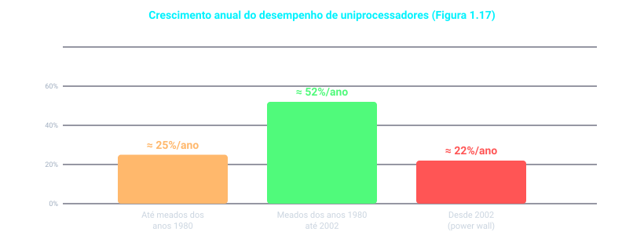

- **Até meados dos anos 1980:** crescimento guiado principalmente pela **tecnologia** (≈ **25%** ao ano).
- **Meados dos anos 1980 até 2002:** ideias mais avançadas de **arquitetura e organização** elevaram o ritmo para ≈ **52%** ao ano. Em 2002, o desempenho era cerca de **7×** maior do que seria mantendo os 25%.
- **Desde 2002:** os limites de **potência**, do **paralelismo no nível de instrução** disponível e da **longa latência de memória** reduziram o ritmo para ≈ **22%** ao ano.

> **Hardware/Software Interface:** O paralelismo sempre foi crucial para o desempenho, mas costumava ficar **escondido**. O _pipelining_ (Capítulo 4) sobrepõe a execução de instruções, e é um exemplo de **paralelismo no nível de instrução**, em que o hardware abstrai o paralelismo e o programador/compilador enxerga uma execução **sequencial**. Obrigar o programador a **conhecer o hardware paralelo** e reescrever os programas era o _"third rail"_ da arquitetura de computadores: empresas que dependeram dessa mudança de comportamento **fracassaram** (Seção 6.15). Por isso é surpreendente que toda a indústria de TI tenha apostado seu futuro na **programação explicitamente paralela**.

## 1.8.2 Por que Programar em Paralelo é Difícil?

| Conceito | Descrição |
| :-- | :-- |
| **1ª razão: é programação de desempenho** | Além de **correto**, resolver um problema importante e ter uma boa interface, o programa precisa ser **rápido**. Se desempenho não for necessário, basta escrever um programa **sequencial**. |
| **2ª razão: dividir bem o trabalho** | Cada processador deve ter **aproximadamente a mesma quantidade de trabalho** ao mesmo tempo, e o *overhead* de escalonamento e coordenação não pode **consumir** o ganho do paralelismo. |

 

> **Analogia: escrever uma matéria de jornal.** Oito repórteres na mesma matéria poderiam, em teoria, escrevê-la **8× mais rápido**. Para isso:
> 
> |Desafio|Na analogia|Na programação paralela|
> |---|---|---|
> |**Escalonamento**|Dividir a matéria para que **todos** tenham algo a fazer ao mesmo tempo|Dividir a aplicação em subtarefas|
> |**Balanceamento de carga**|Se **um** repórter demora mais que os outros sete, o benefício diminui|Distribuir o trabalho de forma **uniforme** para obter o _speedup_ desejado|
> |**Comunicação**|Repórteres que gastam muito tempo conversando entre si|_Overhead_ de comunicação entre as partes|
> |**Sincronização**|A conclusão não pode ser escrita até que todas as outras partes estejam prontas|Tempo gasto esperando outras tarefas|
> 
> **O desafio cresce com o número de repórteres** na matéria e com o **número de processadores** no programa paralelo.

## 1.8.3 Paralelismo ao Longo do Livro

Para refletir essa mudança, os **cinco capítulos seguintes** têm uma seção sobre as implicações da revolução paralela:

|Seção|Tema|Ideia principal|
|---|---|---|
|**2.11**|Paralelismo e Instruções: **Sincronização**|Tarefas paralelas independentes precisam se coordenar às vezes (por exemplo, para avisar que terminaram). Instruções usadas por multicores para **sincronizar** tarefas.|
|**3.6**|Paralelismo e Aritmética: **Paralelismo de subpalavra**|A forma mais simples de paralelismo: operar sobre elementos em paralelo (ex.: multiplicar vetores). Usa a **Lei de Moore** para criar unidades aritméticas mais largas, que operam muitos operandos ao mesmo tempo.|
|**4.10**|Paralelismo via Instruções|Dada a dificuldade do paralelismo explícito, nos anos 1990 houve grande esforço para que **hardware e compilador** descobrissem o paralelismo **implícito**: busca e execução de várias instruções ao mesmo tempo, previsão de desvios e execução **especulativa**.|
|**5.10**|Paralelismo e Hierarquia de Memória: **Coerência de cache**|Todos os processadores usam o **mesmo espaço de endereçamento**, reduzindo o custo de comunicação. Como cada um tem seu _cache_, é preciso mecanismos para manter os dados **consistentes** entre os caches.|
|**5.11**|Paralelismo e Hierarquia de Memória: **RAID**|Usar muitos discos em conjunto oferece **maior vazão**, a inspiração original do RAID. Sua popularidade veio da **dependabilidade** (confiabilidade) dada por discos redundantes.|

Além dessas seções, há um capítulo inteiro sobre processamento paralelo:

- **Capítulo 6:** detalha os desafios da programação paralela; apresenta as duas abordagens de comunicação (**endereçamento compartilhado** e **troca explícita de mensagens**); descreve um modelo restrito de paralelismo, mais fácil de programar; discute a dificuldade de fazer _benchmarks_ de processadores paralelos; introduz um modelo simples de desempenho para multicores; e avalia **quatro exemplos** de microprocessadores multicore com esse modelo.
- Os **Capítulos 3 a 6** usam a **multiplicação matriz-vetor** como exemplo contínuo para mostrar como cada tipo de paralelismo aumenta o desempenho.
- **Apêndice B:** descreve a **GPU** (_graphics processing unit_), presente em computadores desktop. Criada para acelerar gráficos, tornou-se uma plataforma de programação própria e **depende de paralelismo**. O apêndice descreve a GPU da NVIDIA e seu ambiente de programação paralela.

> **Conclusão:** Como o **power wall** impediu o aumento do clock, a indústria passou a aumentar o **número de núcleos** por chip. O ganho de desempenho agora depende do **software**: programadores precisam escrever programas **paralelos** e continuar melhorando seu código conforme o número de núcleos cresce.

## Glossário da Seção

|**Termo**|**Definição**|
|---|---|
|**Core (núcleo)**|Cada processador dentro de um microprocessador _multicore_.|
|**Microprocessador multicore**|Microprocessador com vários processadores (núcleos) no mesmo circuito integrado.|
|**Vazão (_throughput_)**|Quantidade de trabalho concluído por unidade de tempo. Nos multicores, o benefício costuma ser maior aqui do que no tempo de resposta.|
|**Paralelismo no nível de instrução**|Paralelismo escondido do programador (ex.: _pipelining_), em que o hardware executa instruções sobrepostas mas o programa parece sequencial.|
|**Programação explicitamente paralela**|Programas reescritos pelo programador para usar vários processadores de forma consciente.|
|**Balanceamento de carga**|Divisão do trabalho de modo que todos os processadores tenham aproximadamente a mesma quantidade a fazer.|
|**Sincronização**|Coordenação entre tarefas paralelas, por exemplo para sinalizar o término de uma parte do trabalho.|
|**Overhead de comunicação**|Tempo gasto na troca de informações entre processadores, que pode reduzir os ganhos do paralelismo.|
|**Paralelismo de subpalavra**|Operar muitos operandos pequenos simultaneamente em uma unidade aritmética larga (Seção 3.6).|
|**Coerência de cache**|Mecanismos que mantêm consistentes as cópias dos mesmos dados nos caches de diferentes processadores (Seção 5.10).|
|**RAID**|_Redundant Arrays of Inexpensive Disks_: uso de vários discos em conjunto para maior vazão e dependabilidade (Seção 5.11).|
|**GPU**|_Graphics processing unit_: criada para acelerar gráficos, hoje também é plataforma de programação paralela (Apêndice B).|

# 1.9 Real Stuff: Benchmarking o Intel Core i7

Cada capítulo tem uma seção **"Real Stuff"**, que liga os conceitos do livro a um computador que você pode usar no dia a dia. Nesta primeira, o foco é **como o desempenho e a potência são medidos**, usando o **Intel Core i7** como exemplo.

## 1.9.1 SPEC CPU Benchmark

Quem roda sempre os mesmos programas seria o candidato perfeito para avaliar um computador novo: o conjunto de programas forma uma **carga de trabalho (_workload_)**, e bastaria comparar o **tempo de execução** dela nas duas máquinas. A maioria dos usuários não está nessa situação, então recorre a **benchmarks**: programas escolhidos especificamente para medir desempenho, que formam uma carga de trabalho que o usuário espera que **preveja** a carga real.

| Conceito | Descrição |
| :-- | :-- |
| **Workload (carga de trabalho)** | Conjunto de programas rodados em um computador, seja a coleção **real** de aplicações do usuário ou uma construída com programas reais para **aproximar** essa mistura. Especifica os programas e suas **frequências relativas**. |
| **Benchmark** | Programa selecionado para **comparar o desempenho** de computadores. Para "tornar o caso comum rápido" é preciso saber **qual é o caso comum**, por isso os benchmarks são essenciais na arquitetura de computadores. |

 

O **SPEC** (_System Performance Evaluation Cooperative_) é um esforço financiado e apoiado por vários fabricantes para criar **conjuntos padronizados de benchmarks** para sistemas modernos.

- Em **1989**, o SPEC criou o primeiro conjunto, focado no desempenho do processador (hoje chamado **SPEC89**), que evoluiu por **cinco gerações**.
- A mais recente é o **SPEC CPU2006**, com **12 benchmarks de inteiros** (**CINT2006**) e **17 de ponto flutuante** (**CFP2006**).
- Os de inteiros variam de **parte de um compilador C** a um **programa de xadrez** e a uma **simulação de computador quântico**.
- Os de ponto flutuante incluem códigos de **grade estruturada** (elementos finitos), de **métodos de partículas** (dinâmica molecular) e de **álgebra linear esparsa** (dinâmica de fluidos).

### Resultados do CINT2006 no Core i7 920 (2,66 GHz)

|Descrição|Nome|Instruções (×10⁹)|CPI|Ciclo de clock (s ×10⁻⁹)|Tempo de execução (s)|Tempo de referência (s)|**SPECratio**|
|---|---|--:|--:|--:|--:|--:|--:|
|Processamento de strings interpretado|perl|2252|0,60|0,376|508|9770|19,2|
|Compressão por ordenação de blocos|bzip2|2390|0,70|0,376|629|9650|15,4|
|Compilador GNU C|gcc|794|1,20|0,376|358|8050|22,5|
|Otimização combinatória|mcf|221|**2,66**|0,376|221|9120|41,2|
|Jogo de Go (IA)|go|1274|1,10|0,376|527|10490|19,9|
|Busca de sequência gênica|hmmer|2616|0,60|0,376|590|9330|15,8|
|Jogo de xadrez (IA)|sjeng|1948|0,80|0,376|586|12100|20,7|
|Simulação de computador quântico|libquantum|659|**0,44**|0,376|109|20720|**190,0**|
|Compressão de vídeo|h264avc|3793|0,50|0,376|713|22130|31,0|
|Biblioteca de simulação de eventos discretos|omnetpp|367|2,10|0,376|290|6250|21,5|
|Jogos/busca de caminhos|astar|1250|1,00|0,376|470|7020|14,9|
|Parsing de XML|xalancbmk|1045|0,70|0,376|275|6900|25,1|
|**Média geométrica**|–|–|–|–|–|–|**25,7**|

> **Ligação com a Seção 1.6:** o tempo de execução é o produto dos **três fatores** da tabela (equação clássica de desempenho da CPU):
> 
> $$\text{Tempo de CPU} = \text{Contagem de instruções} \times \text{CPI} \times \text{Tempo de ciclo de clock}$$
> 
> Exemplo com o **perl**: $2252 \times 10^9 \times 0{,}60 \times 0{,}376 \times 10^{-9} \approx 508\text{ s}$.
> 
> O **CPI varia por mais de um fator de 5** entre os benchmarks (de 0,44 no libquantum a 2,66 no mcf), enquanto o ciclo de clock é o mesmo para todos, pois a máquina é a mesma.

### SPECratio e a média geométrica

Para simplificar o marketing, o SPEC divulga **um único número** que resume os 12 benchmarks de inteiros. Dividir o tempo de execução de um **processador de referência** pelo tempo do computador avaliado **normaliza** as medidas e gera o **SPECratio**:

$$\text{SPECratio} = \frac{\text{Tempo de referência}}{\text{Tempo de execução medido}}$$

- Maior SPECratio significa **mais rápido**: ele é o **inverso do tempo de execução**.
- O resumo (CINT2006 ou CFP2006) é a **média geométrica** dos SPECratios:

$$\text{Média geométrica} = \sqrt[n]{\prod_{i=1}^{n} \text{Razão de tempo de execução}_i}$$

em que $\text{Razão de tempo de execução}_i$ é o tempo normalizado em relação ao computador de referência para o $i$-ésimo dos $n$ programas, e $\prod a_i$ é o produto $a_1 \times a_2 \times \dots \times a_n$.

> **Elaboração (por que média geométrica?):** Ao comparar dois computadores por SPECratios, a **média geométrica** dá a **mesma resposta relativa** não importa qual computador seja usado para normalizar. Se os tempos normalizados fossem combinados por **média aritmética**, o resultado **variaria conforme a máquina de referência escolhida**.

## 1.9.2 SPEC Power Benchmark

Com a importância crescente de **energia e potência**, o SPEC criou um benchmark para medi-las. Ele registra o **consumo de servidores em diferentes níveis de carga**, em incrementos de **10%**, ao longo de um período.

O **SPECpower** nasceu de outro benchmark do SPEC, para **aplicações Java empresariais** (**SPECJBB2005**), que exercita processadores, caches e memória principal, além da **máquina virtual Java**, do compilador, do _garbage collector_ e de partes do sistema operacional. O desempenho é medido em **vazão**, em **operações de negócio por segundo** (**ssj_ops**).

### Resultados do SPECpower_ssj2008

Servidor com **2 soquetes Intel Xeon X5650 (2,66 GHz)**, 16 GB de DRAM e um SSD de 100 GB:

|Carga alvo|Desempenho (ssj_ops)|Potência média (W)|
|--:|--:|--:|
|100%|865.618|258|
|90%|786.688|242|
|80%|698.051|224|
|70%|607.826|204|
|60%|521.391|185|
|50%|436.757|170|
|40%|345.919|157|
|30%|262.071|146|
|20%|176.061|135|
|10%|86.784|121|
|0%|0|80|
|**Soma total**|**4.787.166**|**1922**|
|**Σ ssj_ops / Σ potência**||**2490**|

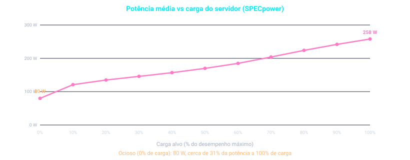

- A potência **não cai a zero** quando o servidor está ocioso: com **0% de carga** ele ainda consome **80 W**, contra **258 W** a 100%.
- Por isso a **eficiência energética** (ssj_ops por watt) é pior em cargas baixas.

Mais uma vez, para simplificar o marketing, o SPEC reduz esses números a um só, o **"overall ssj_ops per watt"**:

$$\text{overall ssj\textunderscore ops per watt} = \frac{\sum_{i=0}^{10} \text{ssj\textunderscore ops}_i}{\sum_{i=0}^{10} \text{potência}_i}$$

em que $\text{ssj\textunderscore ops}_i$ é o desempenho em cada incremento de 10% e $\text{potência}_i$ é a potência consumida naquele nível de desempenho.

> **Exemplo com a tabela:** $\dfrac{4.787.166}{1922} \approx 2490$ ssj_ops por watt.

## Glossário da Seção

| **Termo**                        | **Definição**                                                                                                                                                       |
| -------------------------------- | ------------------------------------------------------------------------------------------------------------------------------------------------------------------- |
| **Workload (carga de trabalho)** | Conjunto de programas rodados em um computador, real ou construído para aproximar a mistura de aplicações do usuário. Especifica programas e frequências relativas. |
| **Benchmark**                    | Programa selecionado para comparar o desempenho de computadores.                                                                                                    |
| **SPEC**                         | _System Performance Evaluation Cooperative_: esforço de fabricantes para criar conjuntos padronizados de benchmarks.                                                |
| **SPEC CPU2006**                 | Conjunto atual de benchmarks de processador: 12 de inteiros (CINT2006) e 17 de ponto flutuante (CFP2006).                                                           |
| **SPECratio**                    | Tempo de execução do processador de referência dividido pelo tempo medido; maior valor significa mais rápido (inverso do tempo de execução).                        |
| **Média geométrica**             | Raiz n-ésima do produto das n razões normalizadas; usada para resumir os SPECratios sem depender da máquina de referência.                                          |
| **SPECpower**                    | Benchmark do SPEC que mede o consumo de servidores em níveis de carga de 10% em 10%.                                                                                |
| **SPECJBB2005**                  | Benchmark do SPEC para aplicações Java empresariais, base do SPECpower.                                                                                             |
| **ssj_ops**                      | Operações de negócio por segundo: unidade de desempenho (vazão) do SPECpower.                                                                                       |
| **Overall ssj_ops per watt**     | Métrica única do SPECpower: soma do desempenho nos 11 níveis de carga dividida pela soma da potência.                                                               |

# 1.10 Falácias e Armadilhas

Esta seção, presente em todos os capítulos, explica **equívocos comuns**. Uma **falácia** é uma ideia errada muito difundida (o livro tenta dar um **contraexemplo**). Uma **armadilha** é um erro fácil de cometer, geralmente uma generalização de um princípio que só vale em um contexto limitado.

## 1.10.1 Armadilha: Esperar que Melhorar um Aspecto Melhore o Desempenho Total na Mesma Proporção

A grande ideia de **"tornar o caso comum rápido"** tem um corolário desanimador: a oportunidade de melhoria depende de **quanto tempo o evento consome**.

**Lei de Amdahl:** a melhoria de desempenho possível com uma dada melhoria é **limitada pela fração de uso** do recurso melhorado. É a versão quantitativa da **lei dos retornos decrescentes**.

$$\text{Tempo após a melhoria} = \frac{\text{Tempo afetado pela melhoria}}{\text{Quantidade de melhoria}} + \text{Tempo não afetado}$$

> **Exemplo:** Um programa roda em **100 s**, e as **multiplicações** respondem por **80 s**. Quanto devo acelerar a multiplicação para o programa ficar **5× mais rápido**?
> 
> Para ser 5× mais rápido, o novo tempo deve ser **20 s**:
> 
> $$20 = \frac{80}{n} + (100 - 80) \;\Rightarrow\; 20 = \frac{80}{n} + 20 \;\Rightarrow\; \frac{80}{n} = 0$$
> 
> **Não existe** valor de $n$ que resolva isso. Se a multiplicação é só **80%** do tempo, nenhuma melhoria nela produz um programa 5× mais rápido.

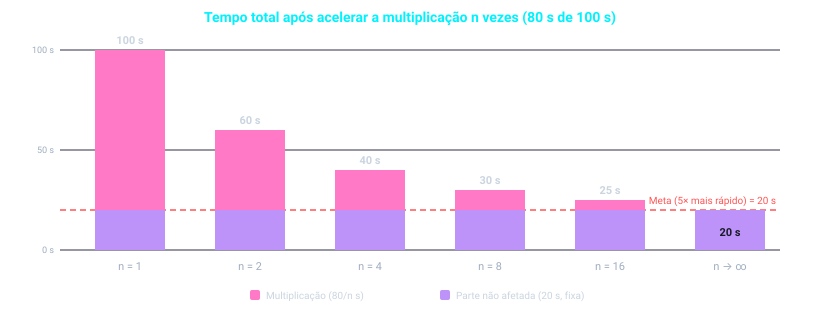

- A parte **não afetada (20 s)** é um **piso**: mesmo com multiplicação instantânea, o programa nunca fica abaixo de 20 s.
- A Lei de Amdahl, junto com a **equação de desempenho da CPU**, é uma boa ferramenta para avaliar melhorias possíveis (os exercícios exploram mais).
- Ela também é usada para argumentar sobre **limites práticos** do número de processadores paralelos (Falácias e Armadilhas do Capítulo 6).

## 1.10.2 Falácia: Computadores com Baixa Utilização Consomem Pouca Potência

A eficiência energética importa em **baixa utilização** porque a carga dos servidores **varia**.

- Em um _warehouse scale computer_ do **Google**, a utilização fica **entre 10% e 50%** na maior parte do tempo e em **100% menos de 1%** do tempo.
- Mesmo com 5 anos para aprender a rodar bem o SPECpower, o computador com melhor resultado em **2012**, especialmente configurado, ainda usava **33% da potência de pico com apenas 10% da carga**. Sistemas reais, não configurados para o benchmark, são certamente piores.
- **Barroso e Hölzle (2007)** defendem a **computação proporcional à energia** (_energy-proportional computing_): se servidores futuros usassem, por exemplo, **10% da potência de pico a 10% da carga**, a conta de eletricidade dos _datacenters_ cairia e as emissões de CO₂ também.

> **Ligação com a Seção 1.9:** o servidor do SPECpower consome 80 W ocioso, contra 258 W a 100%. É exatamente esse comportamento que a falácia ignora.

## 1.10.3 Falácia: Projetar para Desempenho e para Eficiência Energética São Objetivos Independentes

Como **energia é potência ao longo do tempo**, otimizações de hardware ou software que **levam menos tempo** muitas vezes **economizam energia no total**, mesmo que a otimização gaste um pouco mais de energia enquanto está em uso. O motivo é que **todo o resto do computador** continua consumindo energia enquanto o programa roda: reduzir o tempo reduz a energia do sistema inteiro.

$$\text{Energia} = \text{Potência} \times \text{Tempo}$$

## 1.10.4 Armadilha: Usar um Subconjunto da Equação de Desempenho como Métrica

Já vimos o perigo de prever desempenho só pela **taxa de clock**, pela **contagem de instruções** ou pelo **CPI**. Outro erro comum é usar **apenas dois dos três fatores**. Quase todas as alternativas propostas ao **tempo** como métrica levaram a afirmações enganosas, resultados distorcidos ou interpretações incorretas.

### MIPS (milhões de instruções por segundo)

$$\text{MIPS} = \frac{\text{Contagem de instruções}}{\text{Tempo de execução} \times 10^6} = \frac{\text{Taxa de clock}}{\text{CPI} \times 10^6}$$

- **Vantagem:** é fácil de entender, e computadores mais rápidos têm MIPS maior, o que combina com a intuição.
- **Três problemas** ao usar MIPS para comparar computadores:

|#|Problema|Explicação|
|---|---|---|
|1|**Ignora a capacidade das instruções**|Não dá para comparar computadores com **conjuntos de instruções diferentes**, pois as contagens de instruções certamente diferem.|
|2|**Varia entre programas** no mesmo computador|Um computador não tem um único MIPS. O CPI variou por um fator de ~5 no SPEC CPU2006 do Core i7 (Figura 1.18), e o MIPS também.|
|3|**Pode variar independentemente do desempenho** (o mais importante)|Se um programa executa **mais instruções**, mas cada instrução é **mais rápida**, o MIPS sobe sem que o tempo melhore.|

### Check Yourself

|Medição|Computador A|Computador B|
|---|---|---|
|Contagem de instruções|10 bilhões|8 bilhões|
|Taxa de clock|4 GHz|4 GHz|
|CPI|1,0|1,1|

a. Qual computador tem o **MIPS** maior? b. Qual computador é **mais rápido**?

> **Resposta (calculada com as fórmulas acima):**
> 
> - **MIPS:** $A = \dfrac{4 \times 10^9}{1{,}0 \times 10^6} = 4000$ e $B = \dfrac{4 \times 10^9}{1{,}1 \times 10^6} \approx 3636$. **A tem o maior MIPS.**
> - **Tempo:** $A = \dfrac{10 \times 10^9 \times 1{,}0}{4 \times 10^9} = 2{,}5\text{ s}$ e $B = \dfrac{8 \times 10^9 \times 1{,}1}{4 \times 10^9} = 2{,}2\text{ s}$. **B é mais rápido.**
> 
> O computador com **maior MIPS é o mais lento**, o que mostra o problema nº 3.

## Glossário da Seção

|**Termo**|**Definição**|
|---|---|
|**Falácia**|Ideia errada comumente aceita; o livro tenta apresentar um contraexemplo.|
|**Armadilha**|Erro fácil de cometer, geralmente generalização de um princípio válido apenas em contexto limitado.|
|**Lei de Amdahl**|A melhoria de desempenho possível com uma dada melhoria é limitada pela fração de uso do recurso melhorado (retornos decrescentes).|
|**Computação proporcional à energia**|Ideia de projetar servidores cuja potência cresça proporcionalmente à carga, usando pouca potência quando ociosos.|
|**MIPS**|Milhões de instruções por segundo: contagem de instruções dividida por (tempo de execução × 10⁶).|

# 1.11 Comentários Finais

É difícil prever o nível exato de custo/desempenho dos computadores no futuro, mas é seguro apostar que será **muito melhor** que o atual. Para participar desses avanços, projetistas e programadores precisam entender uma **variedade maior de assuntos**.

## 1.11.1 Principais Ideias do Capítulo

| Conceito | Descrição |
| :-- | :-- |
| **Abstração em camadas** | Hardware e software são construídos em **camadas hierárquicas**, em que cada camada inferior esconde detalhes da superior. Isso não significa conhecer apenas **uma** abstração. |
| **Arquitetura do conjunto de instruções** | A abstração mais importante: a interface entre o **hardware** e o **software de baixo nível**. Mantê-la constante permite várias implementações (custo e desempenho diferentes) rodando o **mesmo software**. Por outro lado, pode impedir inovações que exijam mudar a interface. |
| **Silício e Lei de Moore** | O silício é a tecnologia-chave dos processadores modernos. É tão importante quanto entender os **ritmos esperados de mudança tecnológica**, previstos pela Lei de Moore. |

 

- **Duas ideias de organização** melhoraram a relação preço/desempenho: explorar o **paralelismo** do programa (hoje, normalmente via **vários processadores**) e explorar a **localidade** dos acessos a uma **hierarquia de memória** (normalmente via **caches**).
- A **eficiência energética substituiu a área do die** como o recurso mais crítico no projeto de microprocessadores. Economizar potência enquanto se tenta aumentar o desempenho forçou a indústria de hardware a adotar **microprocessadores multicore**, o que obriga a indústria de software a programar hardware paralelo. **O paralelismo agora é necessário para o desempenho.**
- Os computadores sempre foram medidos por **custo e desempenho**, mas também por **energia, dependabilidade, custo de propriedade e escalabilidade**. Este capítulo focou em custo, desempenho e energia, mas os **melhores projetos equilibram todos os fatores** para um dado mercado.

## 1.11.2 A Equação de Desempenho

Existe um método confiável de determinar e relatar desempenho: usar o **tempo de execução de programas reais** como métrica. Ele se relaciona com outras medidas pela equação:

$$\frac{\text{Segundos}}{\text{Programa}} = \frac{\text{Instruções}}{\text{Programa}} \times \frac{\text{Ciclos de clock}}{\text{Instrução}} \times \frac{\text{Segundos}}{\text{Ciclo de clock}}$$

Lembre-se: **individualmente**, os fatores **não** determinam o desempenho. Só o **produto**, que é igual ao tempo de execução, é uma medida confiável.

> **The Big Picture:** O **tempo de execução** é a única medida de desempenho **válida e incontestável**. Muitas outras métricas foram propostas e se mostraram insuficientes: algumas são falhas desde o início por não refletirem o tempo de execução, e outras são boas em um contexto limitado, mas foram estendidas além dele ou usadas sem os esclarecimentos necessários.

## 1.11.3 Roteiro do Livro

Na base dessas abstrações estão os **cinco componentes clássicos** de um computador (Figura 1.5): **caminho de dados, controle, memória, entrada e saída**. Eles também servem de estrutura para os demais capítulos:

|Componente|Onde é tratado|
|---|---|
|**Caminho de dados**|Capítulos 3, 4 e 6 e Apêndice B|
|**Controle**|Capítulos 4 e 6 e Apêndice B|
|**Memória**|Capítulo 5|
|**Entrada**|Capítulos 5 e 6|
|**Saída**|Capítulos 5 e 6|

|Capítulo / Apêndice|Assunto|
|---|---|
|**Capítulo 2**|**Conjuntos de instruções** (a interface entre compiladores e computador), com ênfase no papel de compiladores e linguagens de programação no uso dos recursos do conjunto.|
|**Capítulo 3**|Como os computadores tratam **dados aritméticos**.|
|**Capítulo 4**|Como processadores exploram o **paralelismo implícito**.|
|**Capítulo 5**|Como uma **hierarquia de memória** explora a **localidade**.|
|**Capítulo 6**|**Microprocessadores multicore** explicitamente paralelos, o coração da revolução paralela.|
|**Apêndice A**|Introdução ao **projeto lógico**.|
|**Apêndice B**|O chip gráfico (**GPU**) altamente paralelo.|

# 1.12 Perspectiva Histórica e Leitura Adicional

Cada capítulo do livro tem uma seção de **perspectiva histórica** disponível online (no PDF ela aparece nas páginas numeradas com "54.e"). Ela mostra a **história humana** por trás dos avanços tecnológicos e coloca as conquistas em seu contexto, para que entendamos melhor as forças que moldarão o futuro da computação. Termina com sugestões de leitura adicional.

## 1.12.1 Os Primeiros Computadores Eletrônicos

|Máquina|Ano|O que representa|
|---|---|---|
|**ENIAC** (Eckert e Mauchly, Univ. da Pensilvânia)|revelado em 1946|Considerado o primeiro computador eletrônico de **propósito geral** em operação. Financiado pelo Exército dos EUA, calculava tabelas de tiro de artilharia. Tinha **18.000 válvulas** e fazia **1900 adições por segundo**. Tinha saltos condicionais e era programável, mas programar significava **ligar cabos e ajustar chaves** (de meia hora a um dia).|
|**EDVAC** (proposta em memorando de von Neumann)|1944–1952|Ideia do **programa armazenado**: guardar programas como números. O memorando levou ao termo "computador de von Neumann", que o livro evita por dar crédito demais a von Neumann e de menos a Eckert e Mauchly.|
|**EDSAC** (Maurice Wilkes, Cambridge)|1949|Primeiro computador de **programa armazenado** em escala real e operacional. O protótipo **Mark-I** (Manchester, 1948) poderia ser o primeiro operacional de programa armazenado.|
|**Máquina do IAS** (Bigelow, Burks, Goldstine, von Neumann)|após 1946|Tinha 1024 palavras de 40 bits e era ~**10× mais rápida** que o ENIAC. O relatório do IAS (1946) discutia a maioria dos conceitos de arquitetura modernos.|
|**Whirlwind** (MIT)|1947|Radar em tempo real. Sua principal inovação foi a **memória de núcleo magnético** (2048 palavras de 16 bits), tecnologia de memória principal por quase **30 anos**.|

Outras figuras e controvérsias:

- **Atanasoff** (Iowa State, início dos anos 1940): computador eletrônico de propósito especial, nunca totalmente operacional. Ajudou a **derrubar a patente** de Eckert e Mauchly, mas estes ainda são geralmente creditados pelo primeiro computador eletrônico de propósito geral.
- **Konrad Zuse** (Alemanha, final dos anos 1930/início dos 1940): máquina de propósito especial. O governo alemão não financiou pesquisas com prazo maior que dois anos.
- **Colossus** (Bletchley Park, incluindo Alan Turing, 1943): computadores de propósito especial para **decifrar mensagens** alemãs, mantidos em segredo até 1970.
- **Harvard Mark-I a Mark-IV** (Howard Aiken): os Mark-III e Mark-IV tinham **memórias separadas para instruções e dados**, o que deu origem ao termo **arquitetura Harvard**. Hoje o termo descreve máquinas com memória principal única, mas **caches separados** para instruções e dados.

## 1.12.2 Desenvolvimentos Comerciais

|Ano|Marco|
|---|---|
|**1947**|Eckert e Mauchly fundam a empresa; o **BINAC** (para a Northrop) é mostrado em 1949.|
|**1951**|**UNIVAC I**: primeiro computador comercial de sucesso nos EUA (**48 sistemas**, ≈ US$ 1 milhão). Previu corretamente a eleição presidencial de 1952.|
|**1952**|**IBM 701**: primeiro computador da IBM (19 unidades vendidas). No início dos anos 1950 muitos eram pessimistas sobre o mercado.|
|**1963**|**CDC 6600** (Seymour Cray): primeiro supercomputador, com muitas ideias presentes nos microprocessadores atuais.|
|**1964**|**IBM System/360**: depois de investir **US$ 5 bilhões**, a IBM anuncia uma **família** de seis implementações da mesma arquitetura, com preço e desempenho variando por um fator de **25**. É a abstração de arquitetura virando realidade comercial.|
|**1965**|**PDP-8** (DEC): primeiro **minicomputador**, abaixo de US$ 20.000.|
|**1971**|**Intel 4004**: primeiro **microprocessador**.|
|**1976**|**Cray-1**: primeiro supercomputador **vetorial** comercial; ao mesmo tempo o mais rápido, o mais caro e o de melhor custo/desempenho para programas científicos.|
|**1977**|**Apple II** (Jobs e Wozniak; o livro escreve "Apple IIe"): definiu padrões de baixo custo, alto volume e confiabilidade do computador pessoal.|
|**1981**|**IBM PC**: o computador mais vendido de qualquer tipo, que deu à Intel o microprocessador mais popular e à Microsoft o sistema operacional mais popular. Os primeiros PCs tinham processadores de 16 bits, 64 KB de memória e disquete como único armazenamento não volátil.|

> **Xerox Alto:** protótipo experimental que **inspirou o desktop moderno**. Reuniu **tela gráfica _bit-mapped_** integrada ao computador, **mouse**, **rede local (LAN)** (precursora da Ethernet) e **interface com janelas** com editor **WYSIWYG** e programas de desenho. Também surgiram servidores de arquivos e de impressão e a ligação com a ARPAnet, as primeiras versões de redes no estilo Internet. Influenciou Apple Macintosh, PC IBM, MacOS, Windows e as primeiras _workstations_.

## 1.12.3 Medindo o Desempenho: um Pouco de História

|Etapa|O que aconteceu|
|---|---|
|**Tempo de uma operação**|A primeira medida era o tempo de uma operação individual (como a soma). Deixou de servir quando os tempos das instruções passaram a variar.|
|**Mix de instruções**|Mede-se a frequência relativa das instruções em vários programas e pondera-se o tempo de cada uma, obtendo o tempo médio por instrução (em ciclos, é o **CPI médio**). Daí foi um passo curto até o **MIPS**.|
|**Programas sintéticos**|Com hierarquia de memória e _pipelining_, não existe mais um único tempo por instrução. Surgiram o **Whetstone** (programas científicos em Algol-60, convertido para Fortran) e o **Dhrystone** (ainda usado em alguns círculos embarcados).|
|**Kernels**|Pedaços pequenos e demorados de programas reais, como as **Livermore Loops** (21 fragmentos de laços) e o **Linpack** (parte de uma biblioteca de álgebra linear). Isolam o desempenho de recursos individuais, mas frequentemente **superestimam** o desempenho de aplicações reais.|
|**SPEC (1988)**|Formado por Apollo/HP, DEC, MIPS e Sun, usando programas reais e entradas acordadas. Só foi possível depois de **sistemas operacionais portáteis** e de linguagens de alto nível populares; assim, os compiladores passaram a ser parte do desempenho.|

### Evolução do SPEC

- **SPEC89:** seis benchmarks de ponto flutuante e apenas **quatro de inteiros**. Como o resumo usava a média geométrica normalizada ao VAX-11/780, favorecia máquinas com **bom ponto flutuante**.
- **1991:** adicionada uma medida de **vazão** (várias cópias do benchmark).
- **SPEC92:** novos benchmarks, médias **separadas** para inteiros (SPECINT) e ponto flutuante (SPECFP) e a medida **SPECbase**, que proíbe _flags_ de otimização específicas por programa (o SPECFP chega a ser 15% a 30% maior sem essa restrição).
- **SPEC95:** novos benchmarks, remoção dos que ficaram curtos demais (desempenho >20× maior) e troca da máquina-base para o **Sun SPARCstation 10/40**.
- **SPEC2006:** todos os benchmarks de ponto flutuante são novos. O único sobrevivente do SPEC89 é o compilador **gcc**.
- **2008:** conjuntos para gráficos, computação científica, orientação a objetos, sistemas de arquivos, servidores Web, Java, CAD e **potência**.

## 1.12.4 Computação Embarcada

- Processadores embarcados existem há muito tempo: os primeiros minicomputadores e microprocessadores foram criados para controle em laboratórios e indústrias.
- O processador mais vendido do mundo continua sendo um **microcontrolador de 8 bits** (carros, eletrodomésticos e aplicações simples).
- Do final dos anos 1980 ao início dos 1990 surgiram novas oportunidades (videogames, _set-top boxes_, celulares e PDAs), aumentando a quantidade e o desempenho exigido.
- Inspirado no SPEC, nasceu em **1997** o **EEMBC** (_Embedded Microprocessor Benchmark Consortium_), com kernels organizados em suítes por segmento. A segunda geração foi anunciada em 2007.

## 1.12.5 Meio Século de Progresso

Resumo (Figura e1.12.7) de máquinas citadas:

|Ano|Máquina|Tamanho (pés³)|Potência (W)|Desempenho (adições/s)|Memória (KB)|Preço|
|---|---|--:|--:|--:|--:|--:|
|1951|UNIVAC I|1.000|125.000|2.000|48|US$ 1.000.000|
|1964|IBM S/360 modelo 50|60|10.000|500.000|64|US$ 1.000.000|
|1965|PDP-8|8|500|330.000|4|US$ 16.000|
|1976|Cray-1|58|60.000|166.000.000|32.000|US$ 4.000.000|
|1981|IBM PC|1|150|240.000|256|US$ 3.000|
|1991|HP 9000/750|2|500|50.000.000|16.384|US$ 7.400|
|1996|Intel PPro PC (200 MHz)|2|500|400.000.000|16.384|US$ 4.400|
|2003|Intel Pentium 4 PC (3,0 GHz)|2|500|6.000.000.000|262.144|US$ 1.600|
|2007|AMD Barcelona PC (2,5 GHz)|2|250|20.000.000.000|2.097.152|US$ 800|

> **Conclusão histórica:** depois de ajustar pela inflação, a relação **preço/desempenho melhorou quase 100 bilhões de vezes em 55 anos**, cerca de **58% ao ano**. Em outras palavras: fator de **10.000** de melhoria em custo e **10.000.000** em desempenho.

## Glossário da Seção

| **Termo**                       | **Definição**                                                                                                        |
| ------------------------------- | -------------------------------------------------------------------------------------------------------------------- |
| **ENIAC**                       | Primeiro computador eletrônico de propósito geral amplamente aceito (1946), com 18.000 válvulas.                     |
| **Programa armazenado**         | Ideia de guardar o programa na memória como números (EDVAC, EDSAC).                                                  |
| **Arquitetura Harvard**         | Originalmente, memórias separadas para instruções e dados; hoje, caches separados para instruções e dados.           |
| **Memória de núcleo magnético** | Tecnologia de memória principal introduzida pelo Whirlwind e usada por quase 30 anos.                                |
| **System/360**                  | Família de computadores da IBM (1964) com uma mesma arquitetura e implementações de diferentes preços e desempenhos. |
| **Microprocessador**            | Processador em um único chip; o primeiro foi o Intel 4004 (1971).                                                    |
| **Mix de instruções**           | Frequência relativa das instruções em vários programas, usada para calcular o tempo médio por instrução.             |
| **Programa sintético**          | Benchmark criado a partir de medições de programas reais (Whetstone, Dhrystone).                                     |
| **Kernel**                      | Trecho pequeno e demorado de um programa real, usado como benchmark (Livermore Loops, Linpack).                      |
| **SPECbase**                    | Medida do SPEC que proíbe flags de otimização específicas por programa.                                              |
| **EEMBC**                       | Consórcio de benchmarks para processadores embarcados, criado em 1997.                                               |
